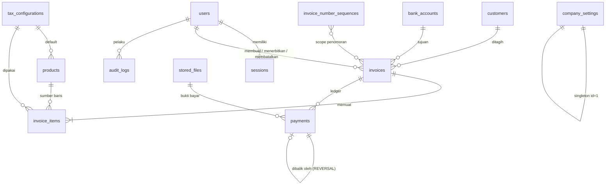

# Arsitektur & Keputusan Desain

Dokumen ini adalah hasil **Tahap 1 (audit & perencanaan)** dan referensi hidup untuk tim web development internal.

## 1. Kondisi repository saat audit

Repository `triogikaedutama` **kosong** (tanpa commit, framework, database, atau infrastruktur). Karena tidak ada teknologi
existing yang harus dipertahankan, fondasi dibangun dari nol mengikuti rekomendasi brief. Lingkungan pengembangan yang tersedia:
Node.js 22, PostgreSQL 16 (lokal), Chromium (untuk E2E), dan akses registry npm.

Dokumen referensi (`Invoice - Demi Chef Januari 2026 CV Bima Satria Jaya.pdf`) dianalisis: dibuat di Word 2019, font Times New Roman,
berisi logo, blok identitas, tabel bergaris putus-putus, Inword/Remark/Transfer Via, ringkasan biaya, cap + tanda tangan. Struktur &
terminologinya menjadi acuan template PDF (lihat §10).

## 2. Keputusan teknologi

| Lapisan | Pilihan | Alasan | Alternatif yang dipertimbangkan |
|---|---|---|---|
| Framework | **Next.js 16** (App Router) + React 19 + TypeScript strict | Satu codebase untuk UI, API, dan server-side logic; didukung luas; mudah dipelihara tim web | Express+Vite (dua proyek, lebih banyak boilerplate) |
| Database | **PostgreSQL** | Transaksi ACID, row lock, CHECK, trigger, tipe `BIGINT`/`DATE` — esensial untuk penomoran & imutabilitas | MySQL (trigger/CHECK lebih lemah), SQLite (tidak cocok multi-user) |
| ORM | **Prisma 6.19** | Skema deklaratif + migrasi terversi + tipe aman; `$queryRaw` untuk kunci baris & agregasi | Drizzle (bagus, tetapi Prisma lebih familiar untuk tim) |
| UI | Tailwind CSS 4 + komponen sendiri (`src/components/ui`) | Ringan, konsisten, tanpa dependensi komponen berat; `<dialog>` native untuk aksesibilitas | shadcn/MUI (dependensi lebih banyak) |
| PDF | **@react-pdf/renderer** | A4 presisi, flex layout, pemecahan halaman, `fixed` header tabel, tanpa Chromium di server produksi | Puppeteer (berat, butuh browser di server), pdfkit (layout manual) |
| Validasi | **Zod** (skema bersama client/server) | Satu definisi, dua sisi | Yup/Joi |
| Auth | Sesi cookie opaque di DB + **scrypt** (bawaan Node) | Sesi bisa dicabut; tanpa dependensi native; mudah diaudit | JWT stateless (sulit dicabut), Auth.js (berlebihan untuk 3 peran) |
| Test | Vitest + Playwright | Cepat; Playwright memakai build produksi | Jest/Cypress |

Versi yang dipakai sengaja **stabil dan teruji di sini** (Prisma 6.19, TypeScript 5.9) — bukan RC/major terbaru — demi kompatibilitas ekosistem.

## 3. Arsitektur lapisan

```
 Browser ──► Halaman (server component, SSR)  ┐
        └──► Form/aksi (client) ── fetch ──►  │  src/app/api/**/route.ts
                                              ▼
              route()/publicRoute()  → sesi → pemeriksaan Origin (CSRF) → parse body (batas ukuran) → error aman
                                              ▼
              SERVICE (src/server/services)  → assertCan(izin) → Zod → TRANSAKSI → audit (satu transaksi)
                                              ▼
              Prisma  ──►  PostgreSQL  (CHECK constraint + TRIGGER imutabilitas = pagar terakhir)

   src/lib/finance/*  (modul MURNI, tanpa IO)  ◄── dipakai SERVER (otoritatif) dan BROWSER (pratinjau langsung)
```

Aturan yang ditegakkan oleh struktur ini:

1. **Halaman & API tidak berisi logika bisnis** — hanya memanggil service. Service **selalu** memeriksa izin (`assertCan`), jadi izin
   berlaku sama untuk API, halaman server, seed, dan test.
2. **Nilai dari browser tidak dipercaya.** Browser hanya mengirim input mentah (kuantitas, harga, diskon…); server menghitung ulang
   seluruh nominal, jatuh tempo, pajak, dan nomor. Total yang dilihat pengguna dikirim kembali sebagai `expectedTotalAmount`; bila
   server menghitung angka berbeda (mis. tarif pajak berubah), penerbitan ditolak (`409`) agar tidak ada perubahan diam-diam.
3. **Setiap `route()` otomatis** memeriksa sesi, `Origin`/`Sec-Fetch-Site` (CSRF), dan menyamarkan error internal.
   Tes struktural (`tests/unit/api-routes.test.ts`) menggagalkan build bila ada endpoint yang melewati wrapper.
4. **Perubahan data + audit log dalam satu transaksi** — tidak ada perubahan tanpa jejak, atau sebaliknya.

## 4. Model data



| Tabel | Peran | Catatan desain |
|---|---|---|
| `users`, `sessions` | Akun & sesi | `sessions.tokenHash` = SHA-256 token; token mentah hanya di cookie |
| `rate_limit_buckets` | Batas login | Tabel (bukan memori) → berlaku lintas instance |
| `customers` | Master pelanggan | `normalizedName + cityKey` **unik** (pencegahan duplikasi); arsip = `isActive=false` |
| `products` | Produk/layanan | `descriptionTemplate` + placeholder; harga default **bukan** harga invoice |
| `tax_configurations` | Pajak | Tarif dalam basis point, faktor DPP `num/den`, metode `EXCLUSIVE/INCLUSIVE` |
| `company_settings` | Identitas lembaga & kebijakan | Singleton (CHECK `id=1`); tidak ada identitas yang ditanam di kode/PDF |
| `bank_accounts` | Rekening | Satu default (indeks unik parsial); invoice menyimpan snapshot rekening |
| `stored_files` | Logo/cap/tanda tangan/bukti bayar | **Imutabel** (trigger); mengganti logo = baris baru → invoice lama tetap memakai logo lamanya |
| `invoice_number_sequences` | Penghitung nomor per scope | Dialokasikan dengan `UPDATE … RETURNING` (row lock) |
| `invoices` | Dokumen tagihan | Draft tanpa nomor; kolom snapshot (`customerSnapshot`, `companySnapshot`, `taxSnapshot`, `displaySnapshot`, bank*) |
| `invoice_items` | Baris | Menyimpan deskripsi, kuantitas (3 desimal), harga, diskon, pajak **sebagai snapshot** |
| `payments` | **Ledger append-only** | `PAYMENT` (+) dan `REVERSAL` (−, menunjuk asal, unik → sekali dibalik); tidak ada UPDATE/DELETE |
| `audit_logs` | Jejak audit | Append-only (trigger); sebelum/sesudah JSON, pelaku, alasan, IP |

Tidak ada `payment_allocations`: satu pembayaran selalu milik satu invoice (kasus satu transfer untuk banyak invoice dicatat sebagai
beberapa baris dengan referensi yang sama). Tabel tambahan di luar daftar brief: `sessions`, `rate_limit_buckets`, `bank_accounts`,
`stored_files` — masing-masing dibutuhkan oleh fitur keamanan, multi-rekening, dan unggahan.

**Integritas di level database** (migrasi `*_integrity_guards`, diuji dengan SQL mentah):

- Invoice **ISSUED/CANCELLED**: semua kolom isi/nilai/snapshot/nomor tidak dapat diubah; hanya `paidAmount/balanceAmount/paymentStatus`,
  catatan internal, dan transisi `ISSUED→CANCELLED` yang diizinkan. Tidak dapat dihapus. Draft tidak dapat dibatalkan.
- `invoice_items` hanya dapat diubah selagi invoice induk `DRAFT`.
- `payments`, `audit_logs`, `stored_files`: `UPDATE`/`DELETE` ditolak. Pembalikan harus bernilai persis `−` pembayaran asal pada invoice yang sama.
- CHECK: `total = subtotal − diskon tambahan + pajak + transport + administrasi`; `balance = total − paid`; `0 ≤ paid ≤ total`;
  draft tidak bernomor, terbit wajib bernomor; semua nominal ≥ 0.
- Semua relasi `ON DELETE RESTRICT` (tidak ada cascade ke data keuangan).

## 5. Aturan keuangan

**Satuan:** Rupiah bulat. Di database `BIGINT`; di kalkulasi `bigint`; ke aplikasi `number` aman (≤ Rp 999.999.999.999.999). Tidak ada floating-point.
Kuantitas mendukung hingga 3 desimal (disimpan `NUMERIC(14,3)`, dihitung sebagai milli-unit bilangan bulat).

**Urutan perhitungan** (`src/lib/finance/calculate.ts`, seluruhnya eksplisit & diuji):

1. `bruto baris = round_half_up(qty × harga)` → 2. `bersih baris = bruto − diskon baris` → 3. `Subtotal = Σ bersih baris` →
4. diskon tambahan dialokasikan **pro-rata** ke baris (metode sisa terbesar; Σ alokasi = diskon persis) →
5. pajak per konfigurasi pajak: `EXCLUSIVE`: `pajak = round(B × f × tarif)` (**dibulatkan sekali** dari nilai eksak); `INCLUSIVE`: `pajak = round(B × e/(1+e))` (tidak menambah total) →
6. `Total = Subtotal − diskon tambahan + pajak(EXCLUSIVE) + transport + administrasi` →
7. **DP/pembayaran tidak mengurangi Total**; hanya mengurangi **Sisa tagihan** = `Total − Σ ledger`.

Satu-satunya pembulatan: **half-up ke Rupiah penuh** (pada langkah 1 dan 5). `DPP` ditampilkan terpisah dari `Pajak`.

**DP tidak pernah dihitung dua kali:** DP yang diisi pada draft disimpan sebagai `downPaymentAmount` dan, **saat terbit**, otomatis dibuat satu
baris ledger `isDownPayment`. Sejak itu "uang diterima" hanya bersumber dari ledger.

**Definisi laporan** (dashboard & laporan): *Nilai invoice* = Σ total invoice `ISSUED` (menurut tanggal invoice); *Penerimaan kas* = Σ ledger (termasuk DP,
dikurangi pembalikan) menurut tanggal bayar; *Piutang* = Σ saldo invoice `ISSUED`. Draft & batal tidak pernah ikut. Laporan **bukan** laporan akuntansi.

**Overdue** tidak disimpan; diturunkan saat query: `ISSUED ∧ saldo > 0 ∧ jatuh tempo < hari ini (Asia/Jakarta)`. Tidak butuh cron dan tidak pernah basi.

## 6. Kebijakan nomor invoice

| Situasi | Kebijakan |
|---|---|
| Draft | **Tidak bernomor** (tampil "DRAFT"). Draft yang dibuang tidak meninggalkan lubang nomor. |
| Terbit | Nomor dialokasikan **di dalam transaksi penerbitan**: `UPDATE invoice_number_sequences … RETURNING` mengunci satu baris sehingga penerbit paralel diserialkan; `UNIQUE(invoices.number)` sebagai pagar terakhir. |
| Gagal di tengah | Seluruh transaksi di-rollback, termasuk penghitung → tidak ada nomor "hangus". |
| Batal | Invoice batal **tetap memegang nomornya** (status + alasan + pelaku); nomor tidak dipakai ulang. |
| Lompatan | Hanya bila Administrator menaikkan nomor berikutnya secara manual (alasan wajib, tercatat; tidak boleh mundur). |
| Aktivasi | Penerbitan **ditolak** sampai Administrator mengonfirmasi nomor awal dan menyatakan nomor itu belum pernah dipakai. |
| Format | Dapat dikonfigurasi: `{PREFIX} {YYYY} {YY} {MM} {SEQ:n}` (default `{SEQ:5}` → 00434). Reset: tidak pernah / tahunan / bulanan (menurut **tanggal invoice**). Contoh `INV/TE/{YYYY}/{SEQ:4}`. |

Diuji: 10 penerbitan paralel → 10 nomor berurutan; 4 permintaan terbit paralel pada invoice yang sama → tepat 1 berhasil dan 1 nomor terpakai.

## 7. Siklus hidup invoice & pembayaran

```
 DRAFT ──(terbitkan: kunci baris → hitung ulang → nomor → snapshot → DP→ledger → audit)──► ISSUED ──(batal, alasan wajib)──► CANCELLED
   │ edit (optimistic locking `version`), hapus draft                │ pembayaran / pembalikan (ledger)         │ tak dapat diaktifkan kembali
```

- Perubahan setelah terbit: **batalkan lalu terbitkan ulang** (opsi "buat draft pengganti" menautkan invoice baru ke yang batal).
- Invoice dengan pembayaran aktif **tidak dapat dibatalkan** sampai pembayarannya dibalikkan (jejak uang tetap utuh).
- Status pembayaran tersimpan: `UNPAID / PARTIALLY_PAID / PAID`; tampilan menambahkan **Overdue** yang diturunkan.
- Setiap operasi yang menyentuh satu invoice memanggil `lockInvoice` (`SELECT … FOR UPDATE`) → klik ganda, dua tab, atau dua pengguna tidak dapat menimbulkan penerbitan/pembayaran ganda.

## 8. RBAC (least privilege) — ditegakkan di service

| Izin | Admin | Finance | Staff |
|---|:--:|:--:|:--:|
| Dashboard, laporan, pembayaran (lihat) | ✔ | ✔ | — |
| Lihat semua invoice / hanya miliknya | semua | semua | **milik sendiri** |
| Buat/edit/hapus **draft**, duplikasi | ✔ | ✔ | ✔ (draft sendiri) |
| Ubah harga/pajak dari master, baris tanpa produk, diskon | ✔ | ✔ | — |
| Terbitkan, batalkan, unduh PDF invoice terbit | ✔ | ✔ | — (hanya pratinjau draft sendiri) |
| Catat & balikkan pembayaran | ✔ | ✔ | — |
| Pelanggan: lihat/tambah · ubah/arsip | ✔ | ✔ | lihat/tambah · — |
| Produk: lihat · kelola | ✔ | lihat · — | lihat · — |
| Pengaturan: lihat · ubah · penomoran · pajak · pengguna | ✔ semua | lihat saja | — |
| Audit log (lengkap) · riwayat per invoice | ✔ · ✔ | — · ✔ | — · — |

Sumber kebenaran: `src/lib/permissions.ts` (dengan tes). Invoice milik orang lain bagi Staff → **404** (tidak membocorkan keberadaan).

## 9. Audit trail

Dicatat (dengan pelaku, peran, IP, waktu, sebelum/sesudah, alasan): login/logout/gagal, pembuatan & perubahan draft, penerbitan, pembatalan,
duplikasi, penghapusan draft, pembayaran & pembalikan, perubahan master data (pelanggan, produk, pajak, rekening, pengaturan, penomoran),
manajemen pengguna & password, unggah file, **unduhan PDF invoice terbit**, ekspor laporan. Tabel append-only di level database.

## 10. PDF

`src/server/pdf/` — template (`InvoicePdf.tsx`) murni presentasi; `document-data.ts` menyusun data **hanya dari snapshot tersimpan**
(invoice terbit/batal) atau data tersimpan + master saat ini (draft, berwatermark, tanpa cap/tanda tangan). Teks/nominal tidak pernah berasal dari input browser.
Font Times (bawaan PDF) = padanan Times New Roman referensi. Hyphenation dimatikan agar istilah tidak terpotong. Baris terakhir tabel
dipertahankan bersama blok total (`minPresenceAhead`) agar total tidak terpisah dari konteksnya.

Deviasi sadar dari referensi: (a) A4 portrait (sesuai brief) bukan format lebar; (b) nominal rata kanan; (c) nilai nol tetap ditampilkan "0" seperti referensi;
(d) baris *Subtotal/Discount/Sisa Tagihan* hanya muncul bila relevan; (e) nama penandatangan mengikuti brief (`Elva Aditya Fawwaz, S.E.`) — referensi bertuliskan `Elva Aditya S, S.E.` (ubah di Pengaturan).

## 11. Risiko teknis & mitigasi

| Risiko | Mitigasi | Bukti |
|---|---|---|
| Nomor ganda / lubang akibat konkurensi | Row lock + UNIQUE + alokasi dalam transaksi | Tes paralel (service & E2E) |
| Penerbitan ganda (klik ganda) | `lockInvoice` + cek status setelah kunci | Tes 4× paralel → 1 sukses |
| Invoice lama berubah diam-diam | Snapshot + trigger DB + service menolak | Tes SQL langsung ditolak |
| Salah hitung / pembulatan | BigInt, urutan eksplisit, satu pembulatan, CHECK identitas total | Tes unit kalkulasi/terbilang + CHECK DB |
| Cache pembayaran ≠ ledger | Update dalam transaksi + `db:reconcile` | Tes + skrip rekonsiliasi |
| Akses tanpa izin (IDOR/privilege) | `assertCan` di service, filter visibilitas, 404 | Tes service + E2E API |
| CSRF / brute force / XSS / upload berbahaya | Origin check, rate limit di DB, React escaping + CSP, validasi magic-bytes | Tes E2E; [SECURITY.md](SECURITY.md) |
| Kehilangan data | Backup terverifikasi + latihan restore + audit append-only | Skrip + latihan DR |
| Ketergantungan versi (react-pdf, Next 16) | Versi dikunci lockfile; CI menjalankan build + E2E | `.github/workflows/ci.yml` |
| Hari libur nasional pada "hari kerja" | Belum ada kalender libur (dokumentasikan); fungsi menerima daftar libur | [BUSINESS-DECISIONS.md](BUSINESS-DECISIONS.md) |

## 12. Status implementasi terhadap brief

Seluruh bagian 3–19 brief **terimplementasi dan teruji**. Hal yang sengaja belum ada / perlu keputusan dicatat di
[BUSINESS-DECISIONS.md](BUSINESS-DECISIONS.md) (mis. token API untuk integrasi server-to-server, MFA, kalender libur, PPh pemotongan oleh pelanggan).
